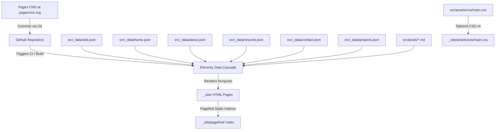

# Technical Architecture & Engineering Guide

> In-depth architectural documentation for developers, contributors, and maintainers of the **Soumil Seal Portfolio & Editorial System**.

---

## 🏛️ System Overview

The site is built as a zero-runtime-overhead static publication prioritizing:
1. **Deterministic Build Pipeline**: Fast, reliable compilation with 11ty, Tailwind v4, and Pagefind.
2. **Strict Technical Blueprint Design System**: Consistent 8pt grid metrics with zero-gap borders.
3. **Decoupled Data Architecture**: Content is separated into structured JSON and Markdown files consumed globally by Nunjucks templates.
4. **Resilient Client Mechanics**: GSAP animation loop with seamless ticker cloning, local dark mode preference detection, and offline search indexing.

---

## 📊 Data Cascade & Architecture

Eleventy compiles static HTML by evaluating templates against a hierarchical data cascade:



### 1. Global Data Files (`src/_data/`)
Eleventy automatically mounts all `.json` files in `src/_data/` as top-level template variables matching their filenames:
- `site.json` $\rightarrow$ available in templates as `site`
- `home.json` $\rightarrow$ available in templates as `home`
- `about.json` $\rightarrow$ available in templates as `about`
- `resume.json` $\rightarrow$ available in templates as `resume`
- `contact.json` $\rightarrow$ available in templates as `contact`
- `projects.json` $\rightarrow$ available in templates as `projects`

### 2. Defensive Template Defaults
All Nunjucks templates utilize fallback operators (`or`):
```nunjucks
{{ home.hero.name or "SOUMIL SEAL" }}
{{ home.sections.contactTitle or "get-in-touch/" }}
```
This guarantees that if an administrator removes or clears a field in Pages CMS, the template renders with a stable default rather than breaking or printing empty strings.

---

## 📐 The Blueprint Design System & Spatial Grid

### 8pt Baseline Grid Alignment
All section headers, dividers, and card borders adhere strictly to the 8pt grid system:

- **Section Header Bars**: Set to `px-4 sm:px-6 py-1.5` (~28px total height), establishing compact blueprint dividers that line up with column guides.
- **Card Padding**: Inner cards use uniform `p-6 sm:p-8` padding for balanced negative space.
- **Container Boundary**: Enclosed in a maximum container width of `950px` (`max-w-[950px] mx-auto border-x border-neutral-300 dark:border-neutral-800`).
- **Dividers**: Clean 1px solid dividers (`border-neutral-300 dark:border-neutral-800`).

### Color Tokens & Dark Mode
Tailwind CSS v4 uses modern CSS variables and color space definitions:
- **Light Surface**: `bg-white` (Pure clean technical background).
- **Light Accents**: `bg-neutral-50/60` and `bg-neutral-50/70` for header micro-bars.
- **Dark Surface**: `bg-neutral-950` (Deep obsidian background).
- **Dark Accents**: `bg-neutral-900/40` for header micro-bars.
- **Borders**: `border-neutral-300` (Light) and `border-neutral-800` (Dark).
- **Accent Primary**: Custom primary blue palette (`primary-500`, `primary-600`) with subtle pulsing status lights.

---

## 🎨 Tailwind CSS v4 Configuration

The styling entrypoint is configured in `src/assets/css/main.css` utilizing Tailwind CSS v4's native `@theme` directives:

```css
@import "tailwindcss";

@theme {
  --font-mono: "JetBrains Mono", ui-monospace, SFMono-Regular, Menlo, Monaco, Consolas, monospace;
  --font-sans: "Inter", system-ui, -apple-system, sans-serif;
  --font-heading: "Cabinet Grotesk", "Inter", system-ui, sans-serif;

  --color-primary-50: #eff6ff;
  --color-primary-100: #dbeafe;
  --color-primary-500: #3b82f6;
  --color-primary-600: #2563eb;
  --color-primary-700: #1d4ed8;
}
```

### Dark Mode Strategy
Dark mode uses class-based activation (`<html class="dark">`). A tiny inline script in the `<head>` of `src/_includes/layouts/base.njk` reads `localStorage.getItem("theme")` or queries `window.matchMedia('(prefers-color-scheme: dark)')` to prevent Flash of Unstyled Content (FOUC).

---

## ⚙️ Custom Eleventy Filters (`.eleventy.js`)

The `.eleventy.js` configuration registers high-utility filters:

| Filter | Usage | Purpose |
| :--- | :--- | :--- |
| `readableDate` | `{{ date \| readableDate }}` | Formats dates as `MMM dd, yyyy` (e.g. `Oct 18, 2026`) |
| `htmlDateString` | `{{ date \| htmlDateString }}` | Formats dates as `yyyy-LL-dd` for `<time datetime="...">` |
| `dateToRfc3339` | `{{ date \| dateToRfc3339 }}` | ISO-8601 formatting for RSS/Atom XML feeds |
| `head` | `{{ array \| head(3) }}` | Slices the first $N$ items from an array |
| `readingTime` | `{{ content \| readingTime }}` | Calculates estimated reading duration (e.g. `4 min read`) |
| `filterTagList` | `{{ tags \| filterTagList }}` | Strips internal 11ty tags (`posts`, `all`) from tag taxonomy |
| `currentYear` | `{{ "" \| currentYear }}` | Generates dynamic current year string for copyright lines |

---

## 🔄 Infinite Marquee Mechanics (GSAP)

The tooling marquee in `src/index.njk` utilizes GreenSock (GSAP) for smooth continuous scrolling:

```javascript
// Continuous infinite marquee with dual-group cloning
const track = document.getElementById("languages-ticker-track");
const groupA = track.querySelector(".languages-ticker-group");
const width = groupA.offsetWidth;

const tween = gsap.to(track, {
  x: -width,
  duration: 28,
  ease: "none",
  repeat: -1,
  modifiers: {
    x: gsap.utils.unitize(x => parseFloat(x) % width)
  }
});

// Pause on hover
track.addEventListener("mouseenter", () => tween.pause());
track.addEventListener("mouseleave", () => tween.play());
```
- **Identical Clones**: `Group A` and `Group B` are rendered side-by-side.
- **Modulo Reset**: When `Group A` translates beyond its width, the modifier seamlessly wraps the translation back to 0 without any visual stutter or jump.

---

## 🔍 Full-Text Static Search (Pagefind)

Search is powered by [Pagefind](https://pagefind.app/):

1. **Build Step**: During `npm run build`, Pagefind analyzes all compiled HTML files in `_site/` containing the `data-pagefind-body` attribute.
2. **Zero Backend**: Pre-computed search chunks are generated into `_site/pagefind/`.
3. **Modal UI**:
   - Pressing `<kbd>Ctrl</kbd> + <kbd>K</kbd>` (or `<kbd>Cmd</kbd> + <kbd>K</kbd>`) opens the modal dialog.
   - Pagefind asynchronously loads only the relevant index chunk for the user's keystrokes, keeping data transfer under a few kilobytes.

---

## 🖨️ Resume Print Optimization (`@media print`)

The resume page (`/resume/`) features dedicated print styles in `src/resume.njk`:
- Hides interactive buttons (`print:hidden`).
- Removes header, footer, and navigation bars to render an ultra-clean, black-and-white CV document.
- Strips shadows and forces high-contrast text for standard A4 paper dimensions and PDF export via `window.print()`.
